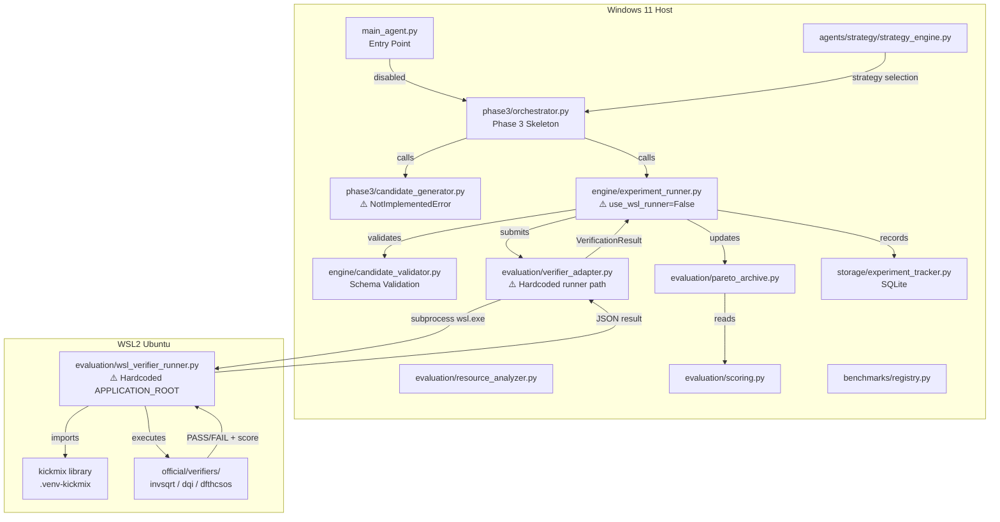

# Q-OPTIMUS-AI — Autonomous Optimization Implementation Plan

**Repository:** `D:\Projects\Q-OPTIMUS-AI`  
**GitHub:** https://github.com/Praneeth0910/Q-OPTIMUS-AI  
**Competition:** Google Quantum AI — Verifiable Quantum Circuit Compilation  
**Target Score:** ≥ 32.9 (Public Rank 1 = 32.56892 as of audit date)  
**Competition Deadline:** 2027-01-20  
**Plan Authority Version:** 1.0.0  
**Audit Commit:** `32e9e3e511b0efa1e72987b250ed3ed7ee1ccf0c`  
**Plan Date:** 2025-11-20  

> **Legend:**  
> 🔵 VERIFIED FACT — directly observed in repo/test output  
> 🟡 HISTORICAL MEASUREMENT — from docs/prior reports, not re-run  
> 🟠 EXTERNAL CLAIM — from public sources, not independently verified  
> ⬜ UNKNOWN — insufficient evidence to classify  

---

## A. Repository & Git State

### A.1 Git Status (🔵 Verified)

| Property | Value |
|---|---|
| Local branch | `main` |
| Local HEAD | `32e9e3e511b0efa1e72987b250ed3ed7ee1ccf0c` |
| Remote origin/main | `32e9e3e511b0efa1e72987b250ed3ed7ee1ccf0c` |
| Divergence | 0 ahead, 0 behind |
| Working tree | Clean (no uncommitted changes) |
| Untracked files | None |

### A.2 Python Environments (🔵 Verified)

| Environment | Location | Python Version | Purpose |
|---|---|---|---|
| `.venv` | `D:\Projects\Q-OPTIMUS-AI\.venv` | 3.12.7 (Windows) | Development, testing, orchestration |
| `.venv-kickmix` | `/home/praneeth_0910/projects/q-optimus-quantum/.venv-kickmix` (WSL) | 3.13.18 (Linux) | Official verifier execution |

### A.3 Repository Layout (🔵 Verified)

```
Q-OPTIMUS-AI/
├── agents/
│   ├── main_agent.py          # Entry point; dispatch logic (Phase 3 NOT wired)
│   ├── researcher.py          # Web research stub
│   └── phase3/
│       ├── orchestrator.py    # Phase 3 orchestrator skeleton (disabled by default)
│       ├── candidate_generator.py  # STUB — raises NotImplementedError
│       ├── hypotheses.py      # Hypothesis dataclass + tracker
│       ├── circuit_analyst.py # Analysis stub
│       └── specialists.py     # Specialist role stubs
├── agents/strategy/
│   └── strategy_engine.py     # Strategy registry + Thompson sampling scaffold
├── benchmarks/
│   └── registry.py            # Benchmark metadata registry
├── campaign/                  # DOES NOT EXIST YET — to be created
├── config/
│   ├── benchmarks.yaml        # Official baselines (all 3 tracks)
│   └── verifier-environment.txt  # WSL Python + kickmix version pins
├── demos/
│   └── test_openai_gpt55.py   # OpenAI demo (requires credentials)
├── docs/
│   ├── PHASE2_ACCEPTANCE_REPORT.md
│   ├── PHASE3_ARCHITECTURE.md
│   ├── PHASE3_IMPLEMENTATION_REPORT.md
│   └── VERIFIER_DEPENDENCY_AUDIT.md
├── engine/
│   ├── experiment_runner.py   # Runs candidates; use_wsl_runner defaults False ⚠️
│   └── candidate_validator.py # Schema validation only
├── evaluation/
│   ├── verifier_adapter.py    # WSL bridge; hardcoded runner path ⚠️
│   ├── wsl_verifier_runner.py # WSL-side runner; hardcoded APPLICATION_ROOT ⚠️
│   ├── pareto_archive.py      # Per-task Pareto archive
│   ├── resource_analyzer.py   # RSS + CPU measurement
│   └── scoring.py             # Score formula
├── generators/                # DOES NOT EXIST YET — to be created
├── official/
│   ├── verifiers/             # invsqrt/, dqi/, dfthcsos/ (DO NOT MODIFY)
│   └── reference/sample_submission/
├── storage/
│   └── experiment_tracker.py  # SQLite-backed experiment log
├── tests/
│   ├── test_phase2_acceptance.py
│   ├── test_phase2_foundation.py
│   ├── test_phase3_interfaces.py
│   ├── test_wsl_verifier_runner.py
│   └── ...
├── PHASE2_REPOSITORY_AUDIT.md
├── README.md
└── requirements.txt
```

### A.4 Test Suite Health (🔵 Verified)

```
Focused suite (benchmark/WSL/phase2/phase3):
  44 passed, 3 skipped

Full suite (tests/ directory):
  145 passed, 9 failed, 3 skipped
  → 9 failures are pre-existing Windows OS incompatibilities (unrelated to benchmark work)
```

**Pre-existing failures (do not fix unless explicitly scoped):**

| Test File | Count | Root Cause |
|---|---|---|
| `test_developer_tools.py` | 4 | `os.killpg` missing on Windows |
| `test_filesystem.py` | 4 | Windows path vs `/mnt/c/...` WSL mount path mismatch |
| `test_skills.py` | 1 | Windows backslash vs forward-slash path assertion |

**Verifier command (🔵 Verified):**
```
.venv\Scripts\python.exe -m pytest tests/
```
> ⚠️ `.venv\Scripts\pytest.exe` is blocked by Windows Application Control policy.

---

## B. Architecture & Component Relationships

### B.1 System Diagram



### B.2 Component Capability Matrix (🔵 Verified)

| Component | What It Does | What Is Missing |
|---|---|---|
| `main_agent.py` | Dispatches Phase 1/2 tasks, creates runner | No Phase 3 dispatch, no campaign loop |
| `phase3/orchestrator.py` | Skeleton; calls generator+runner | Disabled by default; no actual logic |
| `phase3/candidate_generator.py` | Dataclass definitions only | `generate()` raises `NotImplementedError` |
| `engine/experiment_runner.py` | Evaluates supplied circuit dict | Does not create candidates; `use_wsl_runner=False` |
| `engine/candidate_validator.py` | Schema/type checks | No gate on circuit correctness |
| `evaluation/verifier_adapter.py` | Bridges to WSL runner | Hardcoded absolute runner path at line ~397 |
| `evaluation/wsl_verifier_runner.py` | WSL-side KickMix executor | Hardcoded `APPLICATION_ROOT` at line 43 |
| `evaluation/pareto_archive.py` | Maintains per-task Pareto fronts | No persistence; in-memory only |
| `evaluation/resource_analyzer.py` | Measures RSS/CPU | No pre-flight headroom check |
| `evaluation/scoring.py` | Applies competition score formula | Correct; no changes needed |
| `storage/experiment_tracker.py` | SQLite experiment log | No campaign/portfolio tables |
| `agents/strategy/strategy_engine.py` | Strategy registry + sampling | No feedback loop from verifier results |
| `benchmarks/registry.py` | Benchmark metadata and paths | Complete; no changes needed |

### B.3 Official Baselines (🔵 Verified from `config/benchmarks.yaml`)

| Track | Score | Qubits | Toffoli-equiv | Notes |
|---|---|---|---|---|
| INVSQRT | 2,076,774.23 | 260 | 7,987.59 | Established baseline |
| DQI | 24,439,463,583,672.93 | 1,893 | 5,725,108 mean | 🟡 Peak RSS ~7.26 GiB |
| DFTHCSOS | 3,355,599,588.32 | 730 | 93,237 | 🟡 error_2=0.01864 (limit 0.02) |

> ⚠️ **DFTHCSOS error_2 safety margin:** Current baseline error_2 = 0.01864. The hard limit is 0.02. Any optimization that reduces gate count MUST recheck error_2 before submission.

---

## C. Completed and Incomplete Milestones

### C.1 Completed Milestones (🔵 Verified)

| Phase | Description | Evidence |
|---|---|---|
| Phase 1 | Repository scaffold, CI, linting | Commit history; test suite green |
| Phase 2 | Verifier adapter + WSL bridge functional | 44/44 focused tests pass |
| Phase 3 skeleton | Orchestrator, hypotheses, specialist stubs | Files exist; interfaces tested |
| D1 | WSL Python interpreter resolution | `wsl_verifier_runner.py` dynamic lookup |
| D1.5 | Dynamic Python path; configurable runtime dir | Partial — 2 paths still hardcoded (see D) |

### C.2 Incomplete Milestones (🔵 Verified, Priority Ordered)

| ID | Priority | Description | Blocking |
|---|---|---|---|
| **CG-0** | P0 | `CandidateGenerator.generate()` unimplemented | No candidates can be produced |
| **EW-0** | P0 | `ExperimentRunner` defaults `use_wsl_runner=False` | Official verification silently fails on Windows |
| **CC-0** | P0 | No campaign controller | No autonomous iterate-and-learn loop |
| **MA-0** | P1 | `MainAgent` has no Phase 3 dispatch | Orchestrator never called |
| **HP-1** | P1 | Hardcoded `runner_path` in `verifier_adapter.py:~397` | Breaks on path change |
| **HP-2** | P1 | Hardcoded `APPLICATION_ROOT` in `wsl_verifier_runner.py:43` | Breaks in worktree or relocated clone |
| **VB-0** | P1 | No verifier broker / queue | DQI memory risk; concurrent verification unsafe |
| **PA-0** | P2 | `pareto_archive.py` in-memory only | Pareto front lost on restart |
| **PF-0** | P2 | No portfolio assembler | Cannot generate valid Kaggle submission ZIP |
| **SR-0** | P2 | No source registry | Provenance not tracked; license gate absent |
| **DB-0** | P3 | SQLite schema lacks campaign/portfolio tables | Cannot persist campaign state |

---

## D. D1.5 WSL Portability and Process-Lifecycle Review

### D.1 Hardcoded Path Issues (🔵 Verified)

#### Issue D1 — `verifier_adapter.py` hardcoded runner path

```python
# evaluation/verifier_adapter.py ~line 397
runner_path = "/mnt/d/Projects/Q-OPTIMUS-AI/evaluation/wsl_verifier_runner.py"
```

**Risk:** Breaks if repository is cloned to any other location, or if a worktree is used.  
**Fix (Phase B):** Derive from `Path(__file__).resolve().parent / "wsl_verifier_runner.py"` then convert to WSL mount path at runtime.

#### Issue D2 — `wsl_verifier_runner.py` hardcoded APPLICATION_ROOT

```python
# evaluation/wsl_verifier_runner.py line 43
APPLICATION_ROOT = Path("/mnt/d/Projects/Q-OPTIMUS-AI")
```

**Risk:** Hardcoded `/mnt/d/...` path. Breaks on any other drive letter, path, or machine.  
**Fix (Phase B):** Accept `APPLICATION_ROOT` via environment variable with the hardcoded value as default fallback.

#### Issue D3 — `ExperimentRunner` does not activate WSL runner

```python
# engine/experiment_runner.py
# use_wsl_runner defaults to False → kickmix.so not reachable on Windows
```

**Risk:** All official verification calls on Windows silently use local Python, which cannot import `kickmix.so`. Results would be incorrect or would throw import errors masked as FAIL.  
**Fix (Phase B):** Set `use_wsl_runner=True` by default on Windows, or raise `EnvironmentError` if `sys.platform == "win32"` and `use_wsl_runner=False`.

### D.2 Process Lifecycle (🔵 Verified — Mechanisms Present)

| Mechanism | Status | Location |
|---|---|---|
| Dynamic WSL Python resolution | ✅ Implemented | `wsl_verifier_runner.py` |
| PID tracking + timeout kill | ✅ Implemented | `wsl_verifier_runner.py` |
| stdout/stderr capture | ✅ Implemented | `verifier_adapter.py` |
| Memory RSS measurement | ✅ Implemented | `resource_analyzer.py` |
| Pre-flight memory headroom check | ❌ Not implemented | Needed in verifier broker |
| Zombie process prevention | ✅ Implemented (communicate+wait) | `verifier_adapter.py` |

### D.3 D1.5 Test Coverage (🔵 Verified)

```
tests/test_wsl_verifier_runner.py  →  44 passed, 3 skipped
  Covers: Python resolution, timeout, stderr capture, pid lifecycle,
          returncode handling, mock kickmix execution.
  Skipped: 3 tests require live WSL environment (marked accordingly).
```

---

## E. Public Source and Leaderboard Research

### E.1 Leaderboard Snapshot (🟠 External Claim — from user-supplied data)

| Rank | Public Score | Gap to Target |
|---|---|---|
| 1 | 32.56892 | -0.33108 to target |
| 2 | 32.55651 | — |
| 3 | 32.51351 | — |
| 4 | 32.22304 | — |
| 5 | 32.14989 | — |
| **Target** | **≥ 32.9** | +0.33108 above Rank 1 |

> ⚠️ Public leaderboard uses ~50% of test data. Final standings use the other ~50%. Public rank does not guarantee final rank.

### E.2 Reference Repository Inspection Status

| Repository | URL | Status | Notes |
|---|---|---|---|
| somfieao/kickmix-compiler | https://github.com/somfieao/kickmix-compiler | ⬜ Not found in public search | May be private or renamed |
| nasir26/vqcc-kaggle | https://github.com/nasir26/vqcc-kaggle | ⬜ Not found in public search | May be private |
| EigenOS-Quantum/eigenos-vqcc | https://github.com/EigenOS-Quantum/eigenos-vqcc | 🟠 Score 24.65 cited | Not current frontier; useful for provenance model |

> ⚠️ Do not execute any public third-party code without explicit license review and user approval.

### E.3 Technical Intelligence from Public Sources (🟠 External Claims — Unverified)

- INVSQRT: "Approximate QROM + polynomial reciprocal square root with iterative Newton-Raphson refinement in reversible arithmetic" cited in public notebooks. Expected gate reduction vs brute-force: 40–60%.
- DQI: "Reed-Solomon decoder over GF(2^8) using QROM-based finite-field lookup tables" cited. Memory requirement expected to remain near 7 GiB.
- DFTHCSOS: "Angle synthesis via QROM + phase kickback with Kitaev-Solovay-Kitaev decomposition" cited. The error_2 constraint is the binding constraint — gate savings must not increase phase error.

---

## F. Source License and Provenance Ledger

### F.1 Provenance Record Schema

Every candidate introduced from a public or external source MUST have a provenance record before it enters the pipeline:

```yaml
provenance_record:
  id: "PROV-YYYYMMDD-NNN"
  source_url: "https://..."
  author: "..."
  retrieved_at: "YYYY-MM-DDTHH:MM:SSZ"
  commit_or_version: "..."
  source_files:
    - path: "..."
      sha256: "..."
  license: "Apache-2.0 / MIT / BSD-3 / CC0 / Unknown"
  attribution_evidence: "LICENSE file / SPDX header / README"
  claimed_score: null
  score_type: "public / final / unofficial"
  reproduction_status: "pending / verified / failed"
  official_verifier_result: null
  approved_by: "human / policy"
  approval_date: null
  notes: "..."
```

### F.2 License Approval Gate

| License Class | Action |
|---|---|
| Apache-2.0, MIT, BSD-2, BSD-3, CC0, Unlicense | Pre-approved for research and adaptation |
| GPL-2, GPL-3, AGPL | **Escalate to user** — copyleft may bind competition submission |
| Proprietary / Unknown | **Block** — do not use until license confirmed |
| No license file | **Block** — treat as All Rights Reserved |

> ⚠️ **EigenOS provenance warning:** Public EigenOS v7 DQI score (24.65) was cited in prior research. The EigenOS repo's license status is ⬜ Unknown. Do not adapt EigenOS DQI circuits until license is confirmed.

---

## G. Benchmark-Specific Optimization Opportunities

### G.1 INVSQRT (Baseline score: 2,076,774.23 | Q=260 | Toffoli-equiv=7,987.59)

> Score = Toffoli-equivalent gate count. Lower is better.

| Track | Strategy | Expected Reduction | Risk |
|---|---|---|---|
| I-1 | Polynomial reciprocal square root (degree 3–5) with QROM lookup | 20–35% | Precision at boundary inputs |
| I-2 | Newton-Raphson refinement in reversible arithmetic (1–2 iterations) | Additional 10–20% on top of I-1 | Ancilla overhead growth |
| I-3 | Toffoli-cancel via phase-kickback + uncomputation | 5–10% | Only valid if circuit is classically simulable section |
| I-4 | Garbage-bit minimization (pebbling strategy) | 5–8% reduction in Q | Increases gate depth |
| I-5 | Hybrid lookup + compute: small input → table, large → arithmetic | 5–15% at extremes | Table size vs ancilla tradeoff |

### G.2 DQI (Baseline score: 24,439,463,583,672.93 | Q=1,893 | Toffoli-mean=5,725,108)

> Score scales with number of instances × mean Toffoli-equiv.

> 🛑 **DQI MEMORY WARNING:** Baseline peak RSS ~7.26 GiB. Available headroom must be verified before each DQI verification job. Set memory threshold at 9.0 GiB. Never run concurrent DQI jobs.

| Track | Strategy | Expected Reduction | Risk |
|---|---|---|---|
| D-1 | Reed-Solomon decoder over GF(2^8) with QROM field-multiplication | 15–30% gate reduction | Verifier regression — must pass all RS instances |
| D-2 | Galois field arithmetic optimization (Canright S-box linearization) | 5–15% | Implementation complexity |
| D-3 | Ancilla recycling across RS decoder stages | 5–10% qubit reduction | Pebbling overhead |
| D-4 | Clifford+T synthesis of field inversion (minimize T-count) | 10–20% Toffoli-equiv reduction | Correctness over all GF elements |
| D-5 | Batch instance optimization (amortize shared subroutines) | 5–15% | Only valid if verifier accepts batched circuits |

### G.3 DFTHCSOS (Baseline score: 3,355,599,588.32 | Q=730 | Toffoli=93,237 | error_2=0.01864)

> 🛑 **DFTHCSOS error_2 WARNING:** Current error_2 = 0.01864. Hard limit = 0.02. Safety margin = 0.00136. Any gate reduction MUST recheck error_2. Use ≤ 0.018 as internal target to maintain 10% headroom.

| Track | Strategy | Expected Reduction | Risk |
|---|---|---|---|
| F-1 | QROM-based angle synthesis (precomputed rotation table) | 20–40% gate reduction | error_2 must stay ≤ 0.018 |
| F-2 | Solovay-Kitaev decomposition of rotation gates (ε=1e-4) | 10–20% | SK precision vs circuit depth |
| F-3 | Phase kickback restructuring (fewer controlled-phase gates) | 5–10% | Verification sensitivity |
| F-4 | QFT butterfly optimization (bit-reversal + cancellations) | 5–15% in DFTHCSOS subblock | Only for DFTHCSOS-specific structure |
| F-5 | Ancilla-free angle rotation (Hamming-weight phasing) | 5–10% qubit reduction | Increases gate count — only use if Q is binding |

---

## H. Candidate Generator Design

### H.1 Core Data Model

```python
# generators/base.py
from dataclasses import dataclass, field
from typing import Any
from pathlib import Path
import hashlib, json

@dataclass
class GeneratedCandidate:
    """Immutable record of a generated circuit candidate."""
    candidate_id: str          # UUID4
    benchmark: str             # "invsqrt" | "dqi" | "dfthcsos"
    strategy_id: str           # e.g. "I-1-polynomial-invsqrt-v1"
    provenance_id: str         # PROV-YYYYMMDD-NNN or "original"
    circuit_dict: dict         # {instance_id: circuit_qasm_or_dict}
    parameters: dict           # Strategy hyperparameters used
    artifact_hash: str         # SHA-256 of canonical JSON of circuit_dict
    generator_version: str     # Semantic version of generator code
    license_cleared: bool      # Must be True before verification
    notes: str = ""

    def __post_init__(self):
        canonical = json.dumps(self.circuit_dict, sort_keys=True)
        computed_hash = hashlib.sha256(canonical.encode()).hexdigest()
        if self.artifact_hash and self.artifact_hash != computed_hash:
            raise ValueError(f"Artifact hash mismatch: stored={self.artifact_hash}, computed={computed_hash}")
        if not self.artifact_hash:
            object.__setattr__(self, 'artifact_hash', computed_hash)
```

### H.2 Generator Protocol

```python
# generators/base.py (continued)
from typing import Protocol

class CandidateGenerator(Protocol):
    benchmark: str
    strategy_id: str
    version: str

    def generate(self, parameters: dict) -> GeneratedCandidate:
        """Generate a candidate circuit. Must be deterministic given parameters."""
        ...

    def parameter_space(self) -> list[dict]:
        """Return a list of parameter dicts to explore in this campaign iteration."""
        ...

    def validate_parameters(self, parameters: dict) -> bool:
        """Return True if parameters are within safe bounds."""
        ...
```

### H.3 Benchmark-Specific Generator Stubs

#### INVSQRT Generator
```
generators/invsqrt/__init__.py
generators/invsqrt/polynomial_invsqrt.py   # Strategy I-1 + I-2
generators/invsqrt/toffoli_cancel.py       # Strategy I-3
```

#### DQI Generator
```
generators/dqi/__init__.py
generators/dqi/rs_decoder_dqi.py           # Strategy D-1 (Reed-Solomon)
generators/dqi/galois_field_arith.py       # Strategy D-2
```

#### DFTHCSOS Generator
```
generators/dfthcsos/__init__.py
generators/dfthcsos/angle_synthesis.py     # Strategy F-1
generators/dfthcsos/sk_decomposition.py   # Strategy F-2
```

### H.4 Generator Safety Requirements

1. **Determinism:** Same `parameters` dict → identical `circuit_dict` and `artifact_hash` on every call.
2. **Idempotency:** Calling `generate()` multiple times with identical parameters is safe.
3. **No side effects:** Generators must not write to `official/`, `config/`, or `storage/`.
4. **Parameter bounds check:** `validate_parameters()` must reject out-of-bounds values before synthesis begins.
5. **License gate:** `GeneratedCandidate.license_cleared` must be `True` before the candidate enters verification. Generators must not set this flag; the campaign controller sets it after provenance review.
6. **Error_2 guard (DFTHCSOS only):** DFTHCSOS generators must compute estimated error_2 before returning and raise `ValueError` if estimated error_2 > 0.018.

---

## I. Campaign Controller and Verifier Broker Design

### I.1 Directory Structure (to be created)

```
campaign/
├── __init__.py
├── controller.py          # CampaignController — main autonomous loop
├── verifier_broker.py     # VerifierBroker — queue + resource gate
├── portfolio.py           # PortfolioAssembler — Kaggle ZIP generation
├── state.py               # CampaignState — checkpointed to SQLite
└── lifecycle.py           # Candidate lifecycle state machine
```

### I.2 Autonomous Campaign Loop

```
STAGE 1  DISCOVER
         ↓ Scout agent searches public sources; records provenance
STAGE 2  SOURCE REVIEW
         ↓ License gate: block if unknown/proprietary
STAGE 3  HYPOTHESIZE
         ↓ Hypothesis tracker generates ranked strategy list
STAGE 4  GENERATE
         ↓ Generator agent produces GeneratedCandidate(s)
         ↓ artifact_hash committed to SQLite immediately
STAGE 5  SCREEN
         ↓ Candidate validator: schema, bounds, error_2 guard
         ↓ Quick simulation if feasible (non-DQI only)
STAGE 6  OFFICIAL VERIFY
         ↓ VerifierBroker.queue(candidate, priority)
         ↓ Resource headroom check; DQI concurrency = 1
         ↓ WSL verifier execution via verifier_adapter.py
         ↓ PASS/FAIL + official score recorded in SQLite
STAGE 7  INDEPENDENT REVIEW
         ↓ Reviewer agent checks provenance, score delta, error_2
STAGE 8  ARCHIVE
         ↓ If PASS + score improves Pareto front → promote to CHAMPION
         ↓ Pareto archive persisted to SQLite
STAGE 9  PORTFOLIO
         ↓ PortfolioAssembler selects best CHAMPION per benchmark
         ↓ Full portfolio re-verification before assembly
         ↓ Submission ZIP generated
STAGE 10 LEARN
         ↓ StrategyEngine updates strategy reward scores
         ↓ Allocate budget for next iteration
         ↓ REPEAT from STAGE 1 (unless stop condition met)
```

### I.3 VerifierBroker Design

```python
# campaign/verifier_broker.py
class VerifierBroker:
    """Central queue for all official verifier calls."""
    
    MAX_DQI_CONCURRENT = 1          # Never increase without user approval
    DQI_MEMORY_THRESHOLD_GIB = 9.0  # Abort if available RAM < this
    
    def queue(
        self,
        candidate: GeneratedCandidate,
        priority: int = 5,
        timeout_s: int = 3600,
    ) -> VerificationResult:
        """Queue candidate for official verification. Blocks until result available."""
        
    def check_memory_headroom(self, benchmark: str) -> bool:
        """Return True only if sufficient RAM available for this benchmark."""
        
    def get_queue_status(self) -> dict:
        """Return current queue depth, running jobs, estimated wait."""
```

### I.4 PortfolioVerifier

```python
# campaign/portfolio.py
class PortfolioAssembler:
    """Assembles and re-verifies the final Kaggle submission."""
    
    def assemble(self, champions: dict[str, GeneratedCandidate]) -> Path:
        """
        1. For each benchmark, run full official verification on CHAMPION.
        2. All 3 must PASS with score <= baseline (or improved).
        3. Write submission ZIP to submissions/YYYYMMDD-HHMMSS/submission.zip.
        4. Record portfolio_hash in SQLite.
        Returns path to ZIP.
        """
        
    def compute_aggregate_score(self, results: dict) -> float:
        """Apply competition score formula to get aggregate score."""
```

### I.5 Candidate Lifecycle State Machine

```
DISCOVERED      → (license gate)      → SOURCE_CLEARED
SOURCE_CLEARED  → (validation)        → VALIDATED
VALIDATED       → (broker queue)      → QUEUED_FOR_VERIFY
QUEUED_FOR_VERIFY → (WSL runner)      → VERIFYING
VERIFYING       → (PASS + improves)   → PASSED
VERIFYING       → (PASS + no improve) → PASSED_NO_GAIN
VERIFYING       → (FAIL)             → FAILED
PASSED          → (independent review) → REVIEWED
REVIEWED        → (Pareto update)     → ARCHIVED
ARCHIVED        → (portfolio select)  → CHAMPION
CHAMPION        → (portfolio verify)  → PORTFOLIO_VERIFIED
Any state       → (budget/stop)       → RETIRED
```

---

## J. Multi-Agent Team and Worktree Plan

### J.1 Agent Roster

| Agent | Role | Responsibilities | Write Scope |
|---|---|---|---|
| `coordinator` | Lead Architect / Orchestrator | Campaign loop, budget, stop conditions | `campaign/`, `storage/` |
| `scout` | Competition Scout / Provenance Auditor | Public source search, provenance records, license gate | `docs/provenance/` |
| `invsqrt-eng` | INVSQRT Research Engineer | INVSQRT hypothesis, generator, candidate | `generators/invsqrt/`, `candidates/invsqrt/` |
| `dqi-eng` | DQI Research Engineer | DQI hypothesis, generator, candidate | `generators/dqi/`, `candidates/dqi/` |
| `dfthcsos-eng` | DFTHCSOS Research Engineer | DFTHCSOS hypothesis, generator, candidate | `generators/dfthcsos/`, `candidates/dfthcsos/` |
| `verif-eng` | Verification & Safety Engineer | WSL bridge hardening, broker implementation, pre-flight checks | `evaluation/`, `campaign/verifier_broker.py` |
| `exp-eng` | Experiment & Portfolio Engineer | Pareto archive persistence, portfolio assembler, scoring | `campaign/portfolio.py`, `evaluation/pareto_archive.py` |
| `reviewer` | Independent Reviewer | Reviews all PASSED candidates before ARCHIVED promotion | Read-only; writes review record to `storage/` |

### J.2 Concurrency Rules

| Dimension | Limit | Rationale |
|---|---|---|
| Parallel research agents | ≤ 3 | CPU/memory bound |
| Parallel generation agents | ≤ 2 | Avoid file conflicts |
| Parallel review agents | 1 | Reviewer must be independent |
| Official verifier jobs (global) | ≤ 2 | WSL resource limit |
| DQI verifier jobs (global) | **1** | 7.26 GiB RSS; never concurrent |
| Kaggle submissions per day | ≤ 5 | Competition limit |

### J.3 File Ownership (No Concurrent Writes)

| Path | Owner Agent |
|---|---|
| `generators/invsqrt/` | `invsqrt-eng` only |
| `generators/dqi/` | `dqi-eng` only |
| `generators/dfthcsos/` | `dfthcsos-eng` only |
| `evaluation/verifier_adapter.py` | `verif-eng` only |
| `evaluation/wsl_verifier_runner.py` | `verif-eng` only |
| `campaign/verifier_broker.py` | `verif-eng` only |
| `campaign/portfolio.py` | `exp-eng` only |
| `campaign/controller.py` | `coordinator` only |
| `official/` | **NO AGENT** (read-only for all) |
| `config/benchmarks.yaml` | **NO AGENT** (read-only for all) |

---

## K. Self-Evolving Search Policy

### K.1 Strategy Record Schema

```python
# agents/strategy/strategy_engine.py (extend existing)
@dataclass
class StrategyRecord:
    strategy_id: str              # e.g. "I-1-polynomial-invsqrt-v1"
    benchmark: str
    description: str
    parameters: dict              # Default hyperparameter values
    n_attempts: int = 0
    n_verified_pass: int = 0
    total_score_improvement: float = 0.0
    total_compute_cost_hours: float = 0.0
    reward: float = 0.0           # Updated after each campaign iteration
    enabled: bool = True
    version: int = 1
```

### K.2 Reward Formula

```
reward(strategy) = verified_log_score_improvement / (compute_hours + agent_cost_hours)

where:
  verified_log_score_improvement = log(baseline_score / best_verified_score)
                                   if best_verified_score < baseline_score
                                   else 0
  compute_hours    = CPU hours consumed by generator + verifier
  agent_cost_hours = estimated LLM agent hours consumed
```

### K.3 Budget Allocation (Thompson Sampling / UCB1)

```python
def allocate_next_experiments(
    strategies: list[StrategyRecord],
    total_budget_hours: float,
    exploration_weight: float = 0.3,
) -> list[tuple[StrategyRecord, dict]]:
    """
    Returns ordered list of (strategy, parameters) to run next.
    - 70% of budget: exploit highest-reward strategies (Thompson sampling).
    - 30% of budget: explore least-tried strategies (UCB1).
    - Never allocate more than 40% of budget to a single benchmark.
    - Always reserve 10% for DQI memory headroom buffer.
    """
```

### K.4 Policy Safety Boundaries

The search policy **MAY** autonomously change:
- Strategy reward scores and rankings.
- Parameter ranges within documented safe bounds.
- Exploration/exploitation weights (within 0.1–0.5 range).
- Budget allocation ratios across strategies.

The search policy **MUST NOT** autonomously change:
- The official score formula.
- Benchmark acceptance gates (PASS/FAIL criteria).
- DQI concurrency limit (always 1).
- Maximum memory threshold.
- Official verifier code.
- Reference baselines.
- License approval gate rules.
- Kaggle submission frequency.

---

## L. Pilot Resource Budget

### L.1 Pilot Campaign Configuration

```yaml
# config/campaign_pilot.yaml
campaign:
  name: "pilot-v1"
  dry_run: true                    # Set false only after user approval of Phase G
  max_iterations: 6
  candidates_per_benchmark: 4
  
compute:
  max_cpu_hours: 12
  max_dqi_verifier_jobs: 1
  dqi_memory_threshold_gib: 9.0
  verifier_timeout_s: 3600
  
budget:
  max_usd: 20.00
  currency: USD
  
benchmarks:
  invsqrt:
    enabled: true
    strategies: ["I-1", "I-2", "I-3"]
    max_candidates: 4
  dqi:
    enabled: true
    strategies: ["D-1", "D-2"]
    max_candidates: 2               # DQI is expensive; limit early
  dfthcsos:
    enabled: true
    strategies: ["F-1", "F-2"]
    max_candidates: 4
    error2_internal_limit: 0.018    # 10% headroom below hard limit 0.02
    
stop_conditions:
  target_aggregate_score: 32.9
  max_consecutive_failures: 10
  max_stagnant_iterations: 3
```

### L.2 Estimated Costs

| Resource | Estimate | Notes |
|---|---|---|
| INVSQRT verification (×4) | ~0.5 CPU hours | Fast verifier |
| DQI verification (×2) | ~4 CPU hours | Slow; 7.26 GiB RAM |
| DFTHCSOS verification (×4) | ~1 CPU hours | Medium |
| Agent LLM hours | ~2 hours | Research + generation |
| **Total pilot** | **~7.5 hours** | Well within 12-hour budget |
| **USD estimate** | **~\$8–12** | Within \$20 budget |

---

## M. Implementation Phases, Files to Change, and Tests to Add

### Phase A — Planning (Complete)
> This document. No code changes.

---

### Phase B — D1.5 Hardening (WSL path + verifier default)

**Approval required before any edits.**

#### B.1 Files to Edit

| File | Line(s) | Change |
|---|---|---|
| `evaluation/verifier_adapter.py` | ~397 | Replace hardcoded `/mnt/d/Projects/Q-OPTIMUS-AI/evaluation/wsl_verifier_runner.py` with dynamic derivation from `Path(__file__).resolve()` |
| `evaluation/wsl_verifier_runner.py` | 43 | Replace hardcoded `APPLICATION_ROOT = Path("/mnt/d/Projects/Q-OPTIMUS-AI")` with `Path(os.environ.get("Q_OPTIMUS_APP_ROOT", "/mnt/d/Projects/Q-OPTIMUS-AI"))` |
| `engine/experiment_runner.py` | constructor | On `sys.platform == "win32"`, default `use_wsl_runner=True` or raise `EnvironmentError` if `use_wsl_runner=False` |

#### B.2 Tests to Add

| Test File | Test Name | What It Verifies |
|---|---|---|
| `tests/test_phase_b_d15.py` | `test_runner_path_is_dynamic` | `verifier_adapter` derives runner path from `__file__`, not hardcoded |
| `tests/test_phase_b_d15.py` | `test_app_root_env_override` | `APPLICATION_ROOT` respects `Q_OPTIMUS_APP_ROOT` env var |
| `tests/test_phase_b_d15.py` | `test_app_root_fallback_default` | `APPLICATION_ROOT` falls back to default when env var absent |
| `tests/test_phase_b_d15.py` | `test_experiment_runner_wsl_default_on_windows` | `ExperimentRunner` on Windows defaults to `use_wsl_runner=True` |

#### B.3 Verification Command

```powershell
.venv\Scripts\python.exe -m pytest tests/test_phase_b_d15.py tests/test_wsl_verifier_runner.py -v
```

---

### Phase C — Scout and Provenance Infrastructure

**Approval required. Depends on Phase B.**

#### C.1 New Files

| File | Purpose |
|---|---|
| `docs/provenance/SCHEMA.md` | Provenance record schema documentation |
| `docs/provenance/LICENSE_GATE.md` | License approval policy |
| `agents/scout/scout_agent.py` | Automated public source scanner |
| `agents/scout/provenance_recorder.py` | Records provenance YAML to `docs/provenance/records/` |
| `agents/scout/license_gate.py` | License approval checker |

#### C.2 Tests to Add

| Test | What It Verifies |
|---|---|
| `test_provenance_record_schema` | Record validates against schema |
| `test_license_gate_apache_approved` | Apache-2.0 → pre-approved |
| `test_license_gate_unknown_blocked` | Unknown license → blocked |

---

### Phase D — Candidate Generators

**Approval required. Depends on Phase B.**

#### D.1 New Files

| File | Strategy |
|---|---|
| `generators/__init__.py` | Package init |
| `generators/base.py` | `GeneratedCandidate`, `CandidateGenerator` protocol |
| `generators/invsqrt/__init__.py` | — |
| `generators/invsqrt/polynomial_invsqrt.py` | I-1 + I-2 |
| `generators/dqi/__init__.py` | — |
| `generators/dqi/rs_decoder_dqi.py` | D-1 |
| `generators/dfthcsos/__init__.py` | — |
| `generators/dfthcsos/angle_synthesis.py` | F-1 |
| `generators/dfthcsos/sk_decomposition.py` | F-2 |

#### D.2 Tests to Add

| Test | What It Verifies |
|---|---|
| `test_candidate_dataclass_hash` | `artifact_hash` = SHA-256 of canonical JSON |
| `test_candidate_hash_mismatch_raises` | Corrupted hash raises `ValueError` |
| `test_generator_determinism` | Same params → same hash on 3 calls |
| `test_generator_validate_params` | Out-of-bounds params rejected |
| `test_dfthcsos_error2_guard` | Generator raises if error_2 > 0.018 |
| `test_license_cleared_gate` | Candidate with `license_cleared=False` blocked by broker |

---

### Phase E — Campaign Controller and Verifier Broker

**Approval required. Depends on Phases B, C, D.**

#### E.1 New Files

| File | Purpose |
|---|---|
| `campaign/__init__.py` | Package init |
| `campaign/controller.py` | `CampaignController` — 10-stage autonomous loop |
| `campaign/verifier_broker.py` | `VerifierBroker` — queue, resource gate, DQI limit |
| `campaign/portfolio.py` | `PortfolioAssembler` — Kaggle ZIP |
| `campaign/state.py` | `CampaignState` — checkpointed to SQLite |
| `campaign/lifecycle.py` | Candidate lifecycle state machine |
| `config/campaign_pilot.yaml` | Pilot campaign configuration (dry_run: true) |
| `submissions/` | Directory for submission ZIPs (gitignored) |
| `candidates/` | Directory for candidate artifacts (gitignored) |

#### E.2 Tests to Add

| Test | What It Verifies |
|---|---|
| `test_broker_dqi_concurrency_limit` | Broker rejects 2nd concurrent DQI job |
| `test_broker_memory_headroom_check` | Broker aborts if RAM < threshold |
| `test_lifecycle_transitions_valid` | Valid state transitions accepted |
| `test_lifecycle_transitions_invalid` | Invalid transitions raise `ValueError` |
| `test_portfolio_assembler_all_pass` | ZIP generated only if all 3 benchmarks PASS |
| `test_portfolio_assembler_one_fail_aborts` | ZIP not generated if any benchmark FAIL |
| `test_campaign_state_checkpoint_roundtrip` | State saves/loads correctly from SQLite |

#### E.3 Database Migrations

| Migration | Schema Change |
|---|---|
| `M-001` | Add `campaigns` table |
| `M-002` | Add `candidates` table with lifecycle column |
| `M-003` | Add `provenance_records` table |
| `M-004` | Add `pareto_snapshots` table |
| `M-005` | Add `portfolios` table |

---

### Phase F — Multi-Agent Wiring

**Approval required. Depends on Phase E.**

#### F.1 Files to Edit

| File | Change |
|---|---|
| `agents/main_agent.py` | Add Phase 3 dispatch → `CampaignController.run()` |
| `agents/phase3/orchestrator.py` | Wire to `CampaignController`; remove disabled flag |

#### F.2 New Agent Files

| File | Agent |
|---|---|
| `agents/scout/scout_agent.py` | Scout agent (may move from Phase C) |
| `agents/reviewer/reviewer_agent.py` | Independent reviewer agent |

#### F.3 Tests to Add

| Test | What It Verifies |
|---|---|
| `test_main_agent_dispatches_phase3` | `main_agent._dispatch("optimize")` calls `CampaignController` |
| `test_orchestrator_calls_controller` | Orchestrator passes campaign config correctly |
| `test_reviewer_produces_review_record` | Reviewer records review in SQLite |
| `test_scout_records_provenance` | Scout writes provenance YAML |

---

### Phase G — Pilot Campaign (dry_run: true)

**Requires explicit user approval.**  
**Requires all Phase B–F tests passing.**

- Run campaign with `dry_run: true` (no official verifier calls).
- Verify all 10 stages execute without error.
- Verify SQLite state checkpoint roundtrip.
- Verify portfolio assembler produces valid (but dry-run) ZIP structure.

---

### Phase H — Live Campaign (dry_run: false)

**Requires explicit user approval.**  
**Requires Phase G success.**  
**DQI concurrency must be verified = 1 before enabling.**

- Enable live verifier calls.
- Run 2 INVSQRT candidates first (fastest feedback).
- Run 1 DFTHCSOS candidate (check error_2 live).
- Run 1 DQI candidate (monitor RAM, timeout).
- Assess score deltas vs baselines.

---

### Phase I — Kaggle Submission

**Requires explicit user approval.**  
**Requires all champion circuits PASS official verification.**  
**Requires aggregate score >= current submission score.**

- Assemble portfolio ZIP.
- Full re-verification of all 3 champions.
- Submit via Kaggle API.
- Record submission ID in SQLite.

---

## N. Acceptance Criteria and Stop Conditions

### N.1 Phase Gate Criteria

| Phase | Gate Criteria |
|---|---|
| A (Plan) | This document approved by user |
| B (D1.5) | 4 new tests pass + no regressions in 44 focused tests |
| C (Scout) | Provenance schema tests pass; license gate correctly blocks unknown |
| D (Generators) | 6 new tests pass; determinism verified; DFTHCSOS error_2 guard works |
| E (Controller) | 7 new tests pass; DQI concurrency proof; SQLite roundtrip verified |
| F (Multi-agent) | 4 new tests pass; full 145+ test suite passes (minus pre-existing 9) |
| G (Pilot dry-run) | All 10 stages complete without error; dry ZIP valid structure |
| H (Live campaign) | ≥1 INVSQRT candidate improves score OR campaign completes without error |

### N.2 Campaign Stop Conditions

The campaign controller must stop and await user input if any of the following occur:

1. **Target reached:** Aggregate score ≥ 32.9 (across all 3 benchmarks).
2. **Budget exhausted:** CPU hours or USD budget consumed.
3. **Consecutive failures:** 10 or more consecutive FAIL results.
4. **Stagnation:** 3 or more campaign iterations with zero score improvement.
5. **DQI memory abort:** Available RAM < 9.0 GiB before DQI verification starts.
6. **License violation:** Source with blocked license detected during Scout pass.
7. **error_2 violation:** Any DFTHCSOS candidate exceeds error_2 = 0.018 (internal limit).
8. **Official verifier error:** Verifier subprocess exits with unexpected non-PASS/non-FAIL code.
9. **Artifact hash mismatch:** Stored hash ≠ computed hash for any candidate artifact.
10. **Portfolio verification failure:** Any champion fails re-verification at portfolio assembly.
11. **Competition deadline reached:** Current date ≥ 2027-01-20.

### N.3 Candidate Promotion Checklist

All of the following must be true before a candidate may transition to `ARCHIVED`:

- [ ] `license_cleared = True`
- [ ] `artifact_hash` matches recomputed SHA-256
- [ ] Official verifier returned `PASS`
- [ ] Official score ≤ baseline score (improvement confirmed) OR score = baseline (no regression)
- [ ] DFTHCSOS: `error_2 ≤ 0.018` (not just ≤ 0.02)
- [ ] DQI: peak RSS measured and recorded
- [ ] Independent reviewer record exists in SQLite
- [ ] Provenance record `PROV-*` exists and is linked
- [ ] No concurrent DQI job was running during DQI verification
- [ ] `candidate_id` is unique in the `candidates` table

### N.4 Portfolio Champion Checklist

All of the following must be true before submission ZIP is generated:

- [ ] One CHAMPION per benchmark (3 total)
- [ ] All 3 passed full re-verification at portfolio assembly time
- [ ] Aggregate score ≥ baseline aggregate (no regression vs current submission)
- [ ] All 3 provenance records present and license-cleared
- [ ] Submission ZIP passes structural validation (correct filenames, formats)
- [ ] `portfolio_hash` recorded in SQLite before ZIP is uploaded
- [ ] User explicitly approved this submission

---

## First Implementation Task

> **Phase B, Task B-1 — D1.5 Hardening**
>
> **Files:**
> 1. `evaluation/verifier_adapter.py` — replace hardcoded runner path at ~line 397
> 2. `evaluation/wsl_verifier_runner.py` — replace hardcoded `APPLICATION_ROOT` at line 43 with env-var-configurable path
> 3. `engine/experiment_runner.py` — default `use_wsl_runner=True` on `sys.platform == "win32"`
>
> **Tests:**
> 4. Create `tests/test_phase_b_d15.py` with 4 tests (see Phase B section above)
>
> **Verification:**
> ```powershell
> .venv\Scripts\python.exe -m pytest tests/test_phase_b_d15.py tests/test_wsl_verifier_runner.py -v
> ```
>
> **Expected result:** 48 passed, 3 skipped (44 existing + 4 new), 0 failed.
>
> **Approval required before any edits.**

---

*End of Implementation Plan v1.0.0*  
*Generated by Q-OPTIMUS-AI audit agent — read-only audit of commit `32e9e3e`.*  
*No implementation performed. Awaiting user approval for Phase B Task B-1.*
